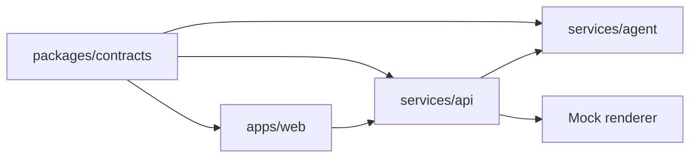

# Vision Studio

Vision Studio turns a musical idea, from text, audio, MIDI, or a track, into editable layers for Stable Audio 3. An agent fills a song brief, asks one question at a time when something is missing, and always produces prompts.

## Run it

```sh
make dev
```

That starts the API on port 8000 and the web app on port 5173. Open [http://127.0.0.1:5173](http://127.0.0.1:5173).

The agent and the renderer stay on their mock providers, so a session never leaves this machine. Fonts are bundled with the web app.

## Demo

Open [http://127.0.0.1:5173/?demo=1](http://127.0.0.1:5173/?demo=1). A small menu runs three seeded scenarios through the local API. Each one ends on take 1.

- **Rainy night.** The text is “a rainy night drive, missing someone”. The run answers “all layers separately”, skips the next question, then skips all and builds.
- **Detected loop.** A local audio fixture is attached. Its key and tempo are detected, so the key question is not asked. The run confirms that reading, then skips all.
- **Summer.** The single word “summer” still produces a full set of prompts.

The fixture is served by the web app at `apps/web/public/fixtures/detected-loop.wav`. Nothing in the demo is fetched from outside localhost.

## Architecture



`packages/contracts` is the JSON Schema for the song brief, a turn, and a render job. The web app and the API both generate their types from it. A session keeps uploads in `audio/`, rendered WAVs in `renders/`, MIDI in `midi/`, and picked files in `export/`.
